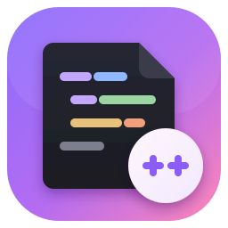
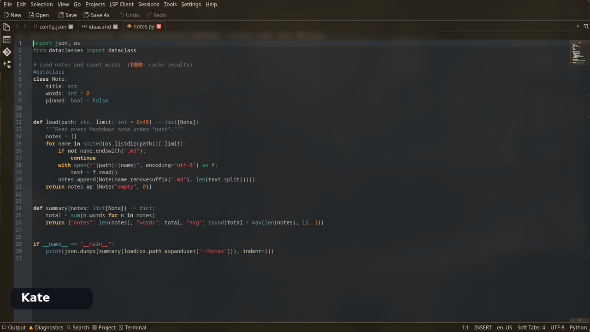
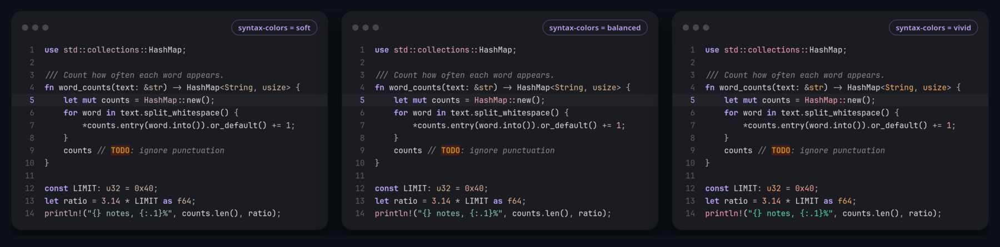
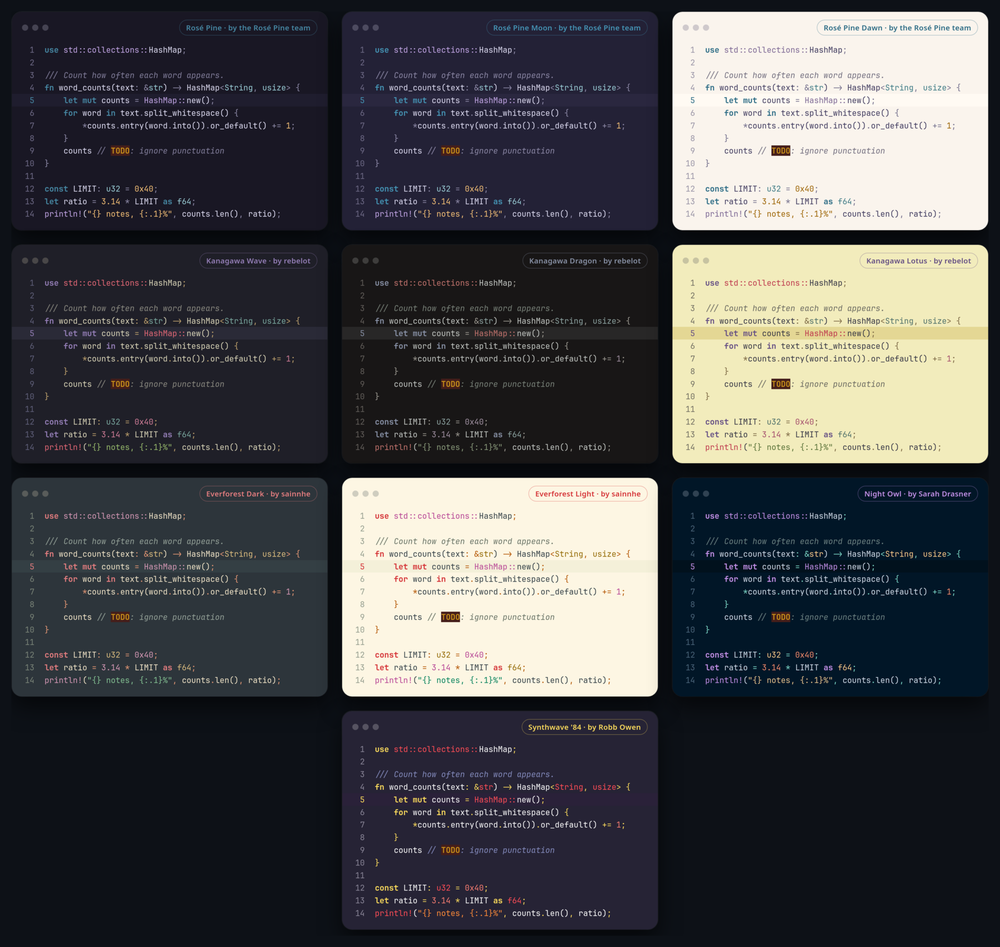

<div align="center">



# Kate++

**Notepad++ comfort for Kate, on any Linux desktop.**

Close it without saving and your tabs are still there next week.<br>
The shortcuts your fingers already know. Colours that match your desktop.

[](https://github.com/AlexD1508/kate-plusplus/releases)
[](https://github.com/AlexD1508/kate-plusplus/actions)
[](LICENSE)
[](https://kate-editor.org)
[](#-install)

<br>



<sub>Stock Kate → Kate++ on a Caelestia desktop. Same files, same machine. <a href="assets/screenshot.png">Full-size screenshot</a></sub>

</div>

<br>

## ✨ What you get

<table>
<tr>
<td width="50%" valign="top">

### 🧠 It remembers everything
Close Kate with unsaved notes and **no save dialog pops up**. Next time you open it, every tab, every unsaved edit and the cursor positions are exactly where you left them, like Notepad++'s session snapshot.
<br><sub>Plus automatic safety snapshots every 10 minutes, so even a crash or power cut can't eat a note.</sub>

</td>
<td width="50%" valign="top">

### ⌨️ Notepad++ shortcuts
<kbd>Ctrl</kbd>+<kbd>D</kbd> duplicate line · <kbd>Ctrl</kbd>+<kbd>H</kbd> replace · <kbd>Ctrl</kbd>+<kbd>K</kbd> comment · <kbd>Ctrl</kbd>+<kbd>Q</kbd> toggle comment · <kbd>Ctrl</kbd>+<kbd>Shift</kbd>+<kbd>R</kbd> / <kbd>P</kbd> record / play macro, and [more](#%EF%B8%8F-shortcuts).
<br><sub>Installed as a switchable shortcut scheme: Kate's originals are one click away.</sub>

</td>
</tr>
<tr>
<td valign="top">

### 🧰 Notepad++ plugin tools, built in
Format / minify JSON, Base64 and URL encode / decode, insert date & time, remove empty or duplicate lines, trim trailing spaces. Works on the selection or the whole file, one undo step each.

</td>
<td valign="top">

### 🎨 Colours that fit your desktop
A **harmonised** syntax theme: strings green, numbers orange, functions blue. Each hue is gently tinted toward your accent colour, so code is calm to look at yet instantly scannable. It follows your **Caelestia wallpaper** or **KDE Plasma colours** live.

</td>
</tr>
<tr>
<td valign="top">

### 🗂️ The Notepad++ layout
A **Language** menu on the menu bar (pick Java for a quick draft, close Kate, and it's still a Java tab weeks later), unlimited tabs with close buttons, double-click the tab bar for a new file, middle-click to close, **document map** (minimap), **function list**, folder-as-workspace, Markdown preview, colour swatches, rainbow brackets.

</td>
<td valign="top">

### 🪄 Pop-up notepad <sup>Caelestia · opt-in</sup>
On a Caelestia + Hyprland desktop you can turn on a hotkey (<kbd>Super</kbd>+<kbd>J</kbd> by default) that slides a floating notepad over whatever you're doing, and hides it again, with its own remembered tabs.

</td>
</tr>
</table>

<br>

## 🚀 Install

You need **Kate** (any distro, native or Flatpak) and **Python 3.9+**, which nearly every distro already has.

```bash
curl -fsSL https://raw.githubusercontent.com/AlexD1508/kate-plusplus/main/install.sh | bash
```

That's it. Kate++ figures out your desktop, backs up your current Kate settings, sets everything up and tells you what it did. Re-running it is safe.

<details>
<summary><b>Arch / EndeavourOS (as a pacman package)</b></summary>

The AUR package is ready and will be published once AUR registration reopens. Until then, build the same package straight from this repo:

```bash
git clone https://github.com/AlexD1508/kate-plusplus.git
cd kate-plusplus/packaging/aur
makepkg -si                  # builds and installs kate-plusplus with pacman
kate-plusplus install        # once per user account
```
Remove it any time with `sudo pacman -R kate-plusplus` (run `kate-plusplus uninstall` first to restore your Kate setup).
</details>

<details>
<summary><b>From a git checkout</b></summary>

```bash
git clone https://github.com/AlexD1508/kate-plusplus.git
cd kate-plusplus
./install.sh
```
</details>

<details>
<summary><b>Install options</b></summary>

```bash
# pass options through the one-liner with  bash -s -- …
curl -fsSL https://raw.githubusercontent.com/AlexD1508/kate-plusplus/main/install.sh | bash -s -- --no-default-editor

  --profile auto|caelestia|generic   force a flavour (default: auto-detect)
  --overlay                          turn on the pop-up notepad (Caelestia)
  --hotkey "SUPER + J"               pop-up notepad key
  --no-overlay                       turn the pop-up notepad off
  --no-default-editor                don't make Kate open text files
  --no-backups                       no automatic snapshots
  -y, --yes                          don't ask anything
```
</details>

<br>

## 🧭 Two flavours, picked automatically

|  | **Caelestia · Hyprland** | **Generic** (Plasma, GNOME, anything) |
|---|:---:|:---:|
| Session memory, no save prompts | ✅ | ✅ |
| Notepad++ shortcuts & tools | ✅ | ✅ |
| Tabs, document map, function list, macros | ✅ | ✅ |
| Safety snapshots & one-command restore | ✅ | ✅ |
| Kate as default text editor | ✅ | ✅ |
| Editor colours | follow your **wallpaper** | follow **KDE Plasma** colours, or Kate++ Dark / Light |
| Window chrome | Caelestia Qt palette | your system theme |
| Pop-up notepad hotkey (opt-in) | ✅ | — |

<br>

## 🎨 Themes

The theme engine keeps every token family on its own familiar hue, nudges it toward your accent, and renders it at matched brightness. Keywords take the accent itself, and the other colours keep their distance so nothing gets confused with a keyword. Every colour is contrast-checked against the background, so **no tweak can make code hard to read**.

<p align="center"></p>

Make it yours in `~/.config/kate-plusplus/config.ini`:

```ini
[theme]
source = auto              # auto | caelestia | plasma | dark | light | none | any theme name ↓
accent = #7aa2f7           # any hex colour, or empty to follow the source
background =               # e.g. #1a1b26
syntax-colors = balanced   # soft | balanced | vivid
```

**The whole window matches too.** Pick Rosé Pine or Dracula and Kate's menus, tabs, sidebars and status bar take on that theme's colours, not just the code. (For themes bundled with Kate, like Dracula, Kate++ reads their colours with `ksyntaxhighlighter6`; without it those keep your desktop's window colours.) With Caelestia or Plasma the window already follows your desktop. Set `window-colors = system` to opt out; a scheme you pick yourself in Kate (*Settings → Window Color Scheme*) after installing is never overwritten. (On first install Kate++ replaces Kate's previous window scheme so everything matches; uninstall puts it back.)

<sub>`accent`, `background` and `syntax-colors` tune the adaptive Kate++ themes (`auto`, `caelestia`, `plasma`, `dark`, `light`). Named themes such as Rosé Pine or Dracula keep their designers' colours.</sub>

<p align="center"></p>

#### 🔍 Try them all, live

```bash
kate-plusplus theme --pick
```

Browse every theme (Kate++'s own, the popular ones, and all of Kate's built-ins) with a real-colour code preview right in your terminal. Previews of Kate's built-in themes use `ksyntaxhighlighter6` (or `kate-syntax-highlighter`); without it you see an install hint instead, and applying them still works. Kate++'s own and the popular themes always preview. Arrow keys or <kbd>j</kbd>/<kbd>k</kbd> to browse, <kbd>Enter</kbd> to apply, <kbd>q</kbd> to cancel. It's also in the `kate-plusplus` menu.

#### 🌈 Popular themes, ready to go

Prefer a classic? Put its name in `source`. Kate++ adds ten favourites that Kate doesn't ship. They're built from each project's official palette and keep its designer's choices, only lifted where needed so every colour meets WCAG AA contrast.

<p align="center"></p>

| `source =` | Variants | Palette by |
|---|---|---|
| `rose-pine` | Rosé Pine · Rosé Pine Moon · Rosé Pine Dawn | [Rosé Pine](https://rosepinetheme.com) |
| `kanagawa` | Kanagawa Wave · Kanagawa Dragon · Kanagawa Lotus | [rebelot](https://github.com/rebelot/kanagawa.nvim) |
| `everforest` | Everforest Dark · Everforest Light | [sainnhe](https://github.com/sainnhe/everforest) |
| `night-owl` | Night Owl | [Sarah Drasner](https://github.com/sdras/night-owl-vscode-theme) |
| `synthwave-84` | Synthwave '84 | [Robb Owen](https://github.com/robb0wen/synthwave-vscode) |

A family name such as `rose-pine` picks the dark or light variant to match your system; a full name such as `Rosé Pine Moon` (or `rose-pine-main`) picks exactly that one. **Every theme that ships with Kate works too**: `Catppuccin Mocha`, `Dracula`, `Nord`, `Tokyo Night`, `gruvbox Dark`, `Atom One Dark`, `Solarized Light`, `Monokai`, `ayu Mirage`, … Capitals and spaces don't matter.

Then `kate-plusplus apply`. With Caelestia or Plasma as the source, the theme regenerates by itself whenever your colours change.

<br>

#### 🔬 Smarter highlighting

With a language server installed, Kate++ turns on Kate's meaning-aware extras: **semantic highlighting** (parameters, types, constants and functions coloured by what they *are*, not just how they look), **inline hints** (parameter names and inferred types in soft grey), hover docs, signature help and error underlines. Each extra appears only where the server supports it: clangd and rust-analyzer offer all of them, while Kate's default Python server (pylsp) gives completion, hover, signatures and errors but no semantic colours or inline hints. For those in Python, install `basedpyright` and point Kate's *LSP Client → User Server Settings* at it:

```json
{ "servers": { "python": { "command": ["basedpyright-langserver", "--stdio"] } } }
```

`kate-plusplus doctor` checks for the servers Kate starts by default (pylsp, clangd, typescript-language-server, rust-analyzer, …) and gives a one-line install hint for missing popular ones. A server you configured yourself, such as basedpyright, isn't detected there. Setting `smart-highlighting = false` under `[editor]` makes Kate++ stop managing these options; it doesn't switch them back off. To disable them, untick them in Kate's *Settings → Configure Kate → LSP Client* after applying.

<sub>Language servers work on saved files (like in VS Code). Unsaved drafts still get regular highlighting, bracket matching, folding and word completion.</sub>

<br>

## ⌨️ Shortcuts

| Action | Kate++ | Kate default |
|---|---|---|
| Duplicate line | <kbd>Ctrl</kbd>+<kbd>D</kbd> | <kbd>Ctrl</kbd>+<kbd>Alt</kbd>+<kbd>↓</kbd> (still works) |
| Find & replace | <kbd>Ctrl</kbd>+<kbd>H</kbd> | <kbd>Ctrl</kbd>+<kbd>R</kbd> (still works) |
| Comment / uncomment | <kbd>Ctrl</kbd>+<kbd>K</kbd> / <kbd>Ctrl</kbd>+<kbd>Shift</kbd>+<kbd>K</kbd> | <kbd>Ctrl</kbd>+<kbd>D</kbd> / <kbd>Ctrl</kbd>+<kbd>Shift</kbd>+<kbd>D</kbd> |
| Toggle comment | <kbd>Ctrl</kbd>+<kbd>Q</kbd> | <kbd>Ctrl</kbd>+<kbd>/</kbd> (still works) |
| Delete line | <kbd>Ctrl</kbd>+<kbd>Shift</kbd>+<kbd>L</kbd> | <kbd>Ctrl</kbd>+<kbd>K</kbd> |
| lowercase / UPPERCASE | <kbd>Ctrl</kbd>+<kbd>U</kbd> / <kbd>Ctrl</kbd>+<kbd>Shift</kbd>+<kbd>U</kbd> | swapped |
| Record / play macro | <kbd>Ctrl</kbd>+<kbd>Shift</kbd>+<kbd>R</kbd> / <kbd>P</kbd> | <kbd>Ctrl</kbd>+<kbd>Shift</kbd>+<kbd>K</kbd> / <kbd>Ctrl</kbd>+<kbd>Alt</kbd>+<kbd>K</kbd> |
| New tab | <kbd>Ctrl</kbd>+<kbd>T</kbd> or <kbd>Ctrl</kbd>+<kbd>N</kbd> | <kbd>Ctrl</kbd>+<kbd>N</kbd> |
| Format JSON | <kbd>Ctrl</kbd>+<kbd>Alt</kbd>+<kbd>Shift</kbd>+<kbd>M</kbd> | — |
| Insert date & time | <kbd>Ctrl</kbd>+<kbd>F5</kbd> | — |
| Move line up / down | <kbd>Ctrl</kbd>+<kbd>Shift</kbd>+<kbd>↑</kbd> / <kbd>↓</kbd> | same |
| Go to line · Find | <kbd>Ctrl</kbd>+<kbd>G</kbd> · <kbd>Ctrl</kbd>+<kbd>F</kbd>, <kbd>F3</kbd> | same |
| Quit | your window manager's close key | <kbd>Ctrl</kbd>+<kbd>Q</kbd> |

Every tool is also in **Tools → Scripts → Notepad++ Tools** and in the command bar (<kbd>Ctrl</kbd>+<kbd>Alt</kbd>+<kbd>I</kbd>, then type its name). The **Language** menu works like Notepad++'s: it sits on the menu bar with every language Kate knows, grouped by kind. You can also click the language name in the status bar for a searchable list.

<br>

## 🛠️ Managing it

Run `kate-plusplus` on its own for a small menu, or:

| Command | What it does |
|---|---|
| `kate-plusplus config` | open your settings, then apply them |
| `kate-plusplus apply` | re-apply `config.ini` |
| `kate-plusplus theme --pick` | browse all themes with a live preview and apply one |
| `kate-plusplus theme` | regenerate the editor theme |
| `kate-plusplus backup` | snapshot sessions & unsaved tabs now |
| `kate-plusplus restore` | pick a snapshot and bring it back |
| `kate-plusplus doctor` | health check (please include it in bug reports) |
| `kate-plusplus update` | update Kate++ and re-apply |
| `kate-plusplus uninstall` | remove Kate++, keep your notes |

<details>
<summary><b>Where things live</b></summary>

| What | Where |
|---|---|
| Your Kate++ settings | `~/.config/kate-plusplus/config.ini` |
| Snapshots | `~/.local/share/kate-plusplus/backups/` |
| Your original Kate settings | `~/.local/state/kate-plusplus/katerc.before-kate-plusplus` |
| Themes | `~/.local/share/org.kde.syntax-highlighting/themes/kate-plusplus-*.theme` |
| Tools script | `~/.local/share/katepart5/script/commands/kate-plusplus.js` |

Kate++ only ever changes the individual settings it manages. Everything else in your Kate config stays as it was.
</details>

<br>

## ❓ FAQ

#### Your notes & settings

<details>
<summary>💾&nbsp; <b>Is my unsaved text really safe?</b></summary>
<br>

> **Yes, three layers deep.**
> 1. **Stash:** closing Kate keeps every unsaved tab and edit for next time.
> 2. **Snapshots** every 10 minutes (only when something changed, kept 2 days): `kate-plusplus restore` brings them back after a crash or power cut.
> 3. **Swap files:** Kate's own recovery for whatever you were typing at that very moment.

</details>

<details>
<summary>⏱️&nbsp; <b>Can it save files automatically, like VS Code?</b></summary>
<br>

> **Yes, opt-in:** set `auto-save = focus` or `auto-save = 30` in the `[editor]` section of `config.ini`, then `kate-plusplus apply`.
> - `focus` saves a modified tab whenever its editor loses keyboard focus: when you switch to another app, but also when you move into another part of Kate, such as the find bar or the file tree.
> - `30` also saves 30 seconds after your last edit.
> - Auto-save applies to every tab that has a file path on your local disk, including a path you opened that doesn't exist yet: Kate creates that file on the first auto-save. Untitled tabs are never auto-saved; they keep living in the stash.

</details>

<details>
<summary>🧷&nbsp; <b>Will it mess up my existing Kate setup?</b></summary>
<br>

> **No, and it's fully reversible.**
> - It backs up your Kate settings and sessions before touching anything.
> - It changes only the individual settings and shortcuts it manages, nothing else.
> - `kate-plusplus uninstall` restores your original settings, shortcuts and file associations.

</details>

#### Shortcuts & themes

<details>
<summary>⌨️&nbsp; <b>Can I change or undo a shortcut?</b></summary>
<br>

> **Any time, in Kate itself:** <b>Settings → Configure Keyboard Shortcuts</b>.
> Kate++ only adds the [Notepad++ ones](#%EF%B8%8F-shortcuts) on top of Kate's defaults, and every other key works exactly as before. Your own changes there are kept, even through updates.

</details>

<details>
<summary>🎨&nbsp; <b>How do I switch themes?</b></summary>
<br>

> **Set `source` in the `[theme]` section of `config.ini`**, then run `kate-plusplus apply`.
> - `auto` follows your Caelestia wallpaper or KDE Plasma colours.
> - `dark` / `light` use the built-in Kate++ themes.
> - Or any theme by name: `rose-pine`, `kanagawa`, `Catppuccin Mocha`, `Dracula`, …
> - Add your own `accent`, `background` or `syntax-colors` to the adaptive themes. Readability is always kept.

</details>

#### Compatibility

<details>
<summary>🐧&nbsp; <b>Which systems does it run on?</b></summary>
<br>

> **Any Linux with Kate 23.08+ and Python 3.9+.** It's tested on Arch / EndeavourOS (Hyprland, Caelestia, KDE Plasma) and Ubuntu. Flatpak Kate (`org.kde.kate`) is used automatically when there's no native Kate.

</details>

<details>
<summary>🪄&nbsp; <b>How do I turn on the pop-up notepad, or change its key?</b></summary>
<br>

> **Caelestia + Hyprland only:** `kate-plusplus install --overlay`, or `--hotkey "SUPER + G"` for another key.
> Kate++ checks for clashes before binding. Turn it off again with `--no-overlay`.

</details>

#### Something's off?

<details>
<summary>🩺&nbsp; <b>A key, the theme or the hotkey isn't working</b></summary>
<br>

> **Run `kate-plusplus doctor`.** It checks every part of the setup and tells you what to fix. Still stuck? [Open an issue](https://github.com/AlexD1508/kate-plusplus/issues/new/choose) with its output.

</details>

<br>

## 🤝 Contributing

Ideas, bug reports and themes are very welcome! See [CONTRIBUTING.md](CONTRIBUTING.md). For bugs, the [issue form](https://github.com/AlexD1508/kate-plusplus/issues/new/choose) asks for the output of `kate-plusplus doctor`, which usually says what's wrong.

<br>

## 💜 Credits

Kate++ is a fan-made companion. It stands entirely on the shoulders of:

- **[Kate](https://kate-editor.org)** by the KDE community: the editor doing all the real work (LGPL-2.0+/GPL). Kate++ only configures it.
- **[Notepad++](https://notepad-plus-plus.org)** by Don Ho and contributors: the editor whose comfort we're recreating (GPL-3.0). No Notepad++ code or artwork is used.
- **[Caelestia](https://github.com/caelestia-dots)**: the desktop whose wallpaper colours the Caelestia flavour follows.
- **[KSyntaxHighlighting](https://invent.kde.org/frameworks/syntax-highlighting)**: the highlighting engine Kate++ themes are written for.
- **Theme palettes**: [Rosé Pine](https://rosepinetheme.com), [Kanagawa](https://github.com/rebelot/kanagawa.nvim) by rebelot, [Everforest](https://github.com/sainnhe/everforest) by sainnhe, [Night Owl](https://github.com/sdras/night-owl-vscode-theme) by Sarah Drasner and [Synthwave '84](https://github.com/robb0wen/synthwave-vscode) by Robb Owen (all MIT).
- **[JetBrains Mono](https://www.jetbrains.com/lp/mono/)**: the default editor font when installed (OFL-1.1).

> Kate++ is an independent project, not affiliated with or endorsed by KDE e.V. or the Notepad++ project. "Kate" and "Notepad++" are the names of their respective projects and are used here only to describe what Kate++ does.

## 📄 License

[MIT](LICENSE) © 2026 AlexD1508 and contributors. The Kate++ icon is original artwork under the same license.

<br>

<p align="center"><sub>Built with help from <a href="https://claude.com/claude-code">Claude Code</a> 🤖💜</sub></p>
