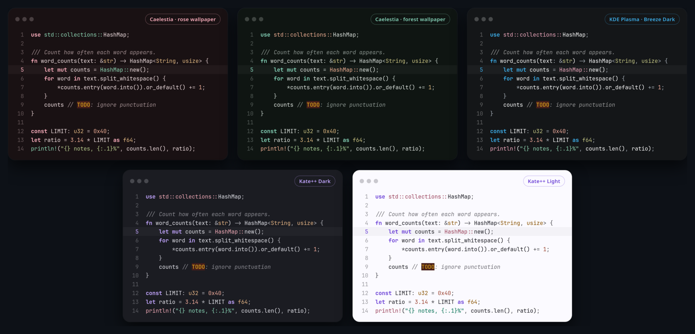

<div align="center">


# Kate++

**Notepad++ comfort for Kate, on any Linux desktop.**

Close it without saving and your tabs are still there next week.<br>
The shortcuts your fingers already know. Colours that match your desktop.

[](https://github.com/AlexD1508/kate-plusplus/releases)
[](https://github.com/AlexD1508/kate-plusplus/actions)
[](LICENSE)
[](https://kate-editor.org)
[](#-install)

<br>



<sub>One theme engine, five moods: it follows your wallpaper, your Plasma colours, or ships its own.</sub>

</div>

<br>

## ✨ What you get

<table>
<tr>
<td width="50%" valign="top">

### 🧠 It remembers everything
Close Kate with unsaved notes and **no save dialog pops up**. Next time you open it, every tab, every unsaved edit and the cursor positions are exactly where you left them, like Notepad++'s session snapshot.
<br><sub>Plus automatic safety snapshots every 10 minutes, so even a crash or power cut can't eat a note.</sub>

</td>
<td width="50%" valign="top">

### ⌨️ Notepad++ shortcuts
<kbd>Ctrl</kbd>+<kbd>D</kbd> duplicate line · <kbd>Ctrl</kbd>+<kbd>H</kbd> replace · <kbd>Ctrl</kbd>+<kbd>K</kbd> comment · <kbd>Ctrl</kbd>+<kbd>Q</kbd> toggle comment · <kbd>Ctrl</kbd>+<kbd>Shift</kbd>+<kbd>R</kbd> / <kbd>P</kbd> record / play macro, and [more](#%EF%B8%8F-shortcuts).
<br><sub>Installed as a switchable shortcut scheme: Kate's originals are one click away.</sub>

</td>
</tr>
<tr>
<td valign="top">

### 🧰 Notepad++ plugin tools, built in
Format / minify JSON, Base64 and URL encode / decode, insert date & time, remove empty or duplicate lines, trim trailing spaces. Works on the selection or the whole file, one undo step each.

</td>
<td valign="top">

### 🎨 Colours that fit your desktop
A **harmonised** syntax theme: strings green, numbers orange, functions blue. Each hue is gently tinted toward your accent colour, so code is calm to look at yet instantly scannable. It follows your **Caelestia wallpaper** or **KDE Plasma colours** live.

</td>
</tr>
<tr>
<td valign="top">

### 🗂️ The Notepad++ layout
Unlimited tabs with close buttons, double-click the tab bar for a new file, middle-click to close, **document map** (minimap), **function list**, folder-as-workspace, Markdown preview, colour swatches, rainbow brackets.

</td>
<td valign="top">

### 🪄 Pop-up notepad <sup>Caelestia</sup>
On a Caelestia + Hyprland desktop, <kbd>Super</kbd>+<kbd>J</kbd> slides a floating notepad over whatever you're doing, and hides it again. It's always running, with its own remembered tabs.

</td>
</tr>
</table>

<br>

## 🚀 Install

You need **Kate** (any distro, native or Flatpak) and **Python 3.9+**, which nearly every distro already has.

```bash
curl -fsSL https://raw.githubusercontent.com/AlexD1508/kate-plusplus/main/install.sh | bash
```

That's it. Kate++ figures out your desktop, backs up your current Kate settings, sets everything up and tells you what it did. Re-running it is safe.

<details>
<summary><b>Arch / EndeavourOS (AUR)</b></summary>

```bash
yay -S kate-plusplus
kate-plusplus install        # once per user account
```
Updates then come with `yay -Syu`.
</details>

<details>
<summary><b>From a git checkout</b></summary>

```bash
git clone https://github.com/AlexD1508/kate-plusplus.git
cd kate-plusplus
./install.sh
```
</details>

<details>
<summary><b>Install options</b></summary>

```bash
# pass options through the one-liner with  bash -s -- …
curl -fsSL https://raw.githubusercontent.com/AlexD1508/kate-plusplus/main/install.sh | bash -s -- --no-default-editor

  --profile auto|caelestia|generic   force a flavour (default: auto-detect)
  --hotkey "SUPER + J"               notepad overlay key (Caelestia)
  --no-overlay                       skip the pop-up notepad
  --no-default-editor                don't make Kate open text files
  --no-backups                       no automatic snapshots
  -y, --yes                          don't ask anything
```
</details>

<br>

## 🧭 Two flavours, picked automatically

|  | **Caelestia · Hyprland** | **Generic** (Plasma, GNOME, anything) |
|---|:---:|:---:|
| Session memory, no save prompts | ✅ | ✅ |
| Notepad++ shortcuts & tools | ✅ | ✅ |
| Tabs, document map, function list, macros | ✅ | ✅ |
| Safety snapshots & one-command restore | ✅ | ✅ |
| Kate as default text editor | ✅ | ✅ |
| Editor colours | follow your **wallpaper** | follow **KDE Plasma** colours, or Kate++ Dark / Light |
| Window chrome | Caelestia Qt palette | your system theme |
| <kbd>Super</kbd>+<kbd>J</kbd> pop-up notepad | ✅ | — |

<br>

## 🎨 Themes

The theme engine keeps every token family on its own familiar hue, nudges it toward your accent, and renders it at matched brightness. Keywords take the accent itself, and the other colours keep their distance so nothing gets confused with a keyword. Every colour is contrast-checked against the background, so **no tweak can make code hard to read**.

<p align="center"></p>

Make it yours in `~/.config/kate-plusplus/config.ini`:

```ini
[theme]
source = auto              # auto | caelestia | plasma | dark | light | none
accent = #7aa2f7           # any hex colour, or empty to follow the source
background =               # e.g. #1a1b26
syntax-colors = balanced   # soft | balanced | vivid
```

<p align="center"></p>

Then `kate-plusplus apply`. With Caelestia or Plasma as the source, the theme regenerates by itself whenever your colours change.

<br>

## ⌨️ Shortcuts

| Action | Kate++ | Kate default |
|---|---|---|
| Duplicate line | <kbd>Ctrl</kbd>+<kbd>D</kbd> | <kbd>Ctrl</kbd>+<kbd>Alt</kbd>+<kbd>↓</kbd> (still works) |
| Find & replace | <kbd>Ctrl</kbd>+<kbd>H</kbd> | <kbd>Ctrl</kbd>+<kbd>R</kbd> (still works) |
| Comment / uncomment | <kbd>Ctrl</kbd>+<kbd>K</kbd> / <kbd>Ctrl</kbd>+<kbd>Shift</kbd>+<kbd>K</kbd> | <kbd>Ctrl</kbd>+<kbd>D</kbd> / <kbd>Ctrl</kbd>+<kbd>Shift</kbd>+<kbd>D</kbd> |
| Toggle comment | <kbd>Ctrl</kbd>+<kbd>Q</kbd> | <kbd>Ctrl</kbd>+<kbd>/</kbd> (still works) |
| Delete line | <kbd>Ctrl</kbd>+<kbd>Shift</kbd>+<kbd>L</kbd> | <kbd>Ctrl</kbd>+<kbd>K</kbd> |
| lowercase / UPPERCASE | <kbd>Ctrl</kbd>+<kbd>U</kbd> / <kbd>Ctrl</kbd>+<kbd>Shift</kbd>+<kbd>U</kbd> | swapped |
| Record / play macro | <kbd>Ctrl</kbd>+<kbd>Shift</kbd>+<kbd>R</kbd> / <kbd>P</kbd> | <kbd>Ctrl</kbd>+<kbd>Shift</kbd>+<kbd>K</kbd> / <kbd>Ctrl</kbd>+<kbd>Alt</kbd>+<kbd>K</kbd> |
| Format JSON | <kbd>Ctrl</kbd>+<kbd>Alt</kbd>+<kbd>Shift</kbd>+<kbd>M</kbd> | — |
| Insert date & time | <kbd>Ctrl</kbd>+<kbd>F5</kbd> | — |
| Move line up / down | <kbd>Ctrl</kbd>+<kbd>Shift</kbd>+<kbd>↑</kbd> / <kbd>↓</kbd> | same |
| Go to line · Find | <kbd>Ctrl</kbd>+<kbd>G</kbd> · <kbd>Ctrl</kbd>+<kbd>F</kbd>, <kbd>F3</kbd> | same |
| Quit | your window manager's close key | <kbd>Ctrl</kbd>+<kbd>Q</kbd> |

Every tool is also in **Tools → Scripts → Notepad++ Tools** and in the command bar (<kbd>Ctrl</kbd>+<kbd>Alt</kbd>+<kbd>I</kbd>, then type its name). The **Language** menu you know from Notepad++ is **Tools → Highlighting**, or click the language name in the status bar.

<br>

## 🛠️ Managing it

Run `kate-plusplus` on its own for a small menu, or:

| Command | What it does |
|---|---|
| `kate-plusplus config` | open your settings, then apply them |
| `kate-plusplus apply` | re-apply `config.ini` |
| `kate-plusplus theme` | regenerate the editor theme |
| `kate-plusplus backup` | snapshot sessions & unsaved tabs now |
| `kate-plusplus restore` | pick a snapshot and bring it back |
| `kate-plusplus doctor` | health check (please include it in bug reports) |
| `kate-plusplus update` | update Kate++ and re-apply |
| `kate-plusplus uninstall` | remove Kate++, keep your notes |

<details>
<summary><b>Where things live</b></summary>

| What | Where |
|---|---|
| Your Kate++ settings | `~/.config/kate-plusplus/config.ini` |
| Snapshots | `~/.local/share/kate-plusplus/backups/` |
| Your original Kate settings | `~/.local/state/kate-plusplus/katerc.before-kate-plusplus` |
| Themes | `~/.local/share/org.kde.syntax-highlighting/themes/kate-plusplus-*.theme` |
| Tools script | `~/.local/share/katepart5/script/commands/kate-plusplus.js` |

Kate++ only ever changes the individual settings it manages. Everything else in your Kate config stays as it was.
</details>

<br>

## ❓ FAQ

<details>
<summary><b>Is my unsaved text really safe?</b></summary>

Kate's built-in <i>stash</i> keeps unsaved tabs and unsaved changes when you close Kate normally. Kate++ adds snapshots every 10 minutes (only when something changed, kept for 2 days by default), so if Kate crashes or the power goes, `kate-plusplus restore` brings them back. Kate's own swap files also recover the text you were typing at the moment of a crash.
</details>

<details>
<summary><b>Will it mess up my existing Kate setup?</b></summary>

Before touching anything, it saves a copy of your Kate settings and a snapshot of your sessions. It merges only its own keys. `kate-plusplus uninstall` puts your original settings back and restores any file associations it changed.
</details>

<details>
<summary><b>Does it work with Flatpak Kate?</b></summary>

Yes. If there's no native Kate, Kate++ configures the Flatpak `org.kde.kate` instead.
</details>

<details>
<summary><b>Can I use Kate's original shortcuts?</b></summary>

Yes: <b>Settings → Configure Keyboard Shortcuts → Shortcut schemes → Default</b>. Switch back to <b>Notepad++</b> whenever you like.
</details>

<details>
<summary><b>The pop-up key clashes with something</b></summary>

Kate++ checks for clashes before binding. Pick any free key with `kate-plusplus install --hotkey "SUPER + G"` or edit `notepad-hotkey` in `config.ini`.
</details>

<br>

## 🤝 Contributing

Ideas, bug reports and themes are very welcome! See [CONTRIBUTING.md](CONTRIBUTING.md). For bugs, the [issue form](https://github.com/AlexD1508/kate-plusplus/issues/new/choose) asks for the output of `kate-plusplus doctor`, which usually says what's wrong.

<br>

## 💜 Credits

Kate++ is a fan-made companion. It stands entirely on the shoulders of:

- **[Kate](https://kate-editor.org)** by the KDE community: the editor doing all the real work (LGPL-2.0+/GPL). Kate++ only configures it.
- **[Notepad++](https://notepad-plus-plus.org)** by Don Ho and contributors: the editor whose comfort we're recreating (GPL-3.0). No Notepad++ code or artwork is used.
- **[Caelestia](https://github.com/caelestia-dots)**: the desktop whose wallpaper colours the Caelestia flavour follows.
- **[KSyntaxHighlighting](https://invent.kde.org/frameworks/syntax-highlighting)**: the highlighting engine Kate++ themes are written for.
- **[JetBrains Mono](https://www.jetbrains.com/lp/mono/)**: the default editor font when installed (OFL-1.1).

> Kate++ is an independent project, not affiliated with or endorsed by KDE e.V. or the Notepad++ project. "Kate" and "Notepad++" are the names of their respective projects and are used here only to describe what Kate++ does.

## 📄 License

[MIT](LICENSE) © 2026 AlexD1508 and contributors. The Kate++ icon is original artwork under the same license.
